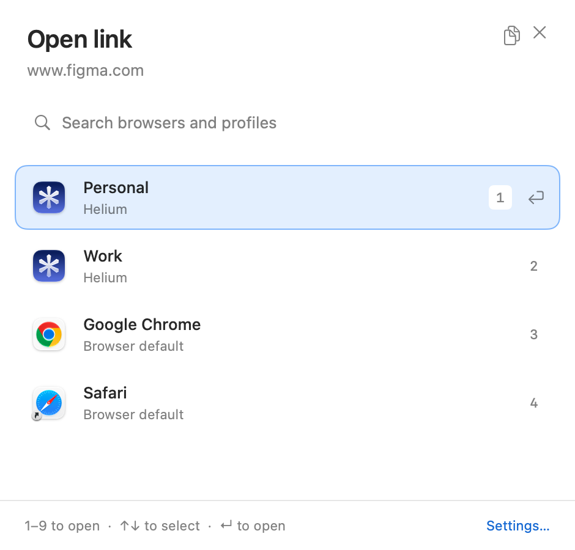
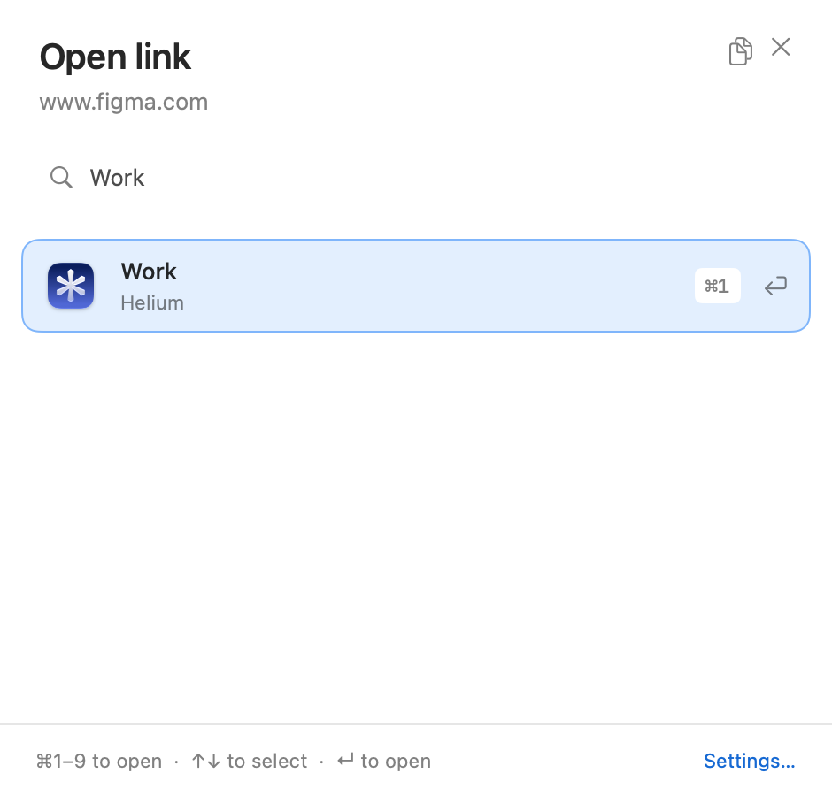

# Number picker verification

Verified October 24, 2026 in a graphical macOS session. The native SwiftUI/AppKit
harness sends keyboard events through `NSApp.sendEvent` into the running picker
and asserts the chosen destination. Preview fixtures record the choice without
launching a browser or changing user configuration.

- Release app build: passed (`./scripts/build-app.sh`).
- Core tests: 6 passed (`swift test`).
- Native interactions: all 16 number scenarios and existing picker, settings,
  and editor checks passed. See [interaction output](interactions.log).
- Screenshots below capture the running native view before the tested keypress.
  Bare `2` chose Work; filtered `⌘1` also chose Work.

Reproduce with `scripts/ui/capture.sh /tmp/ouvre-number-proof --interactions-only`.
The harness writes these two images and prints assertion results. These captures
verify the view layout, not window-compositor effects or VoiceOver narration.

